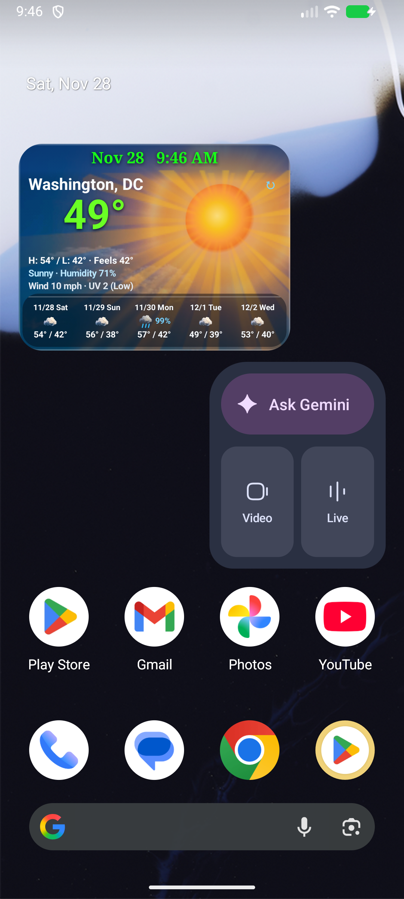
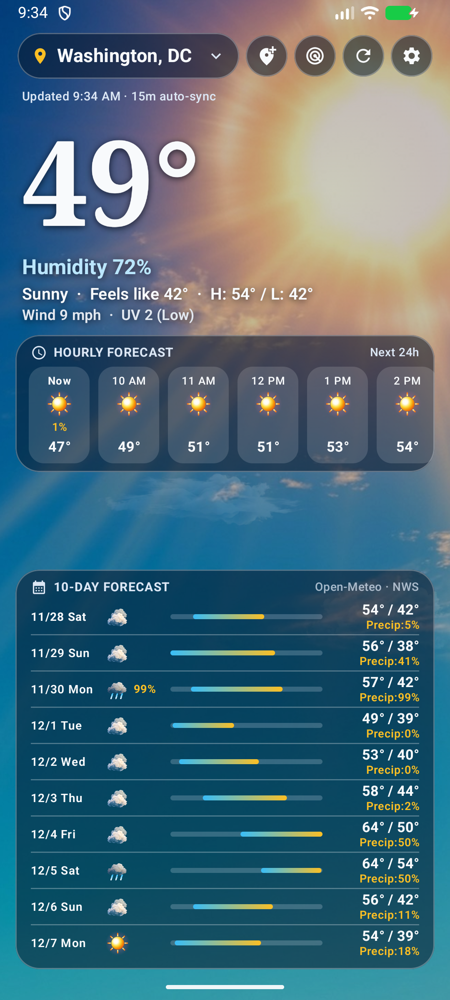
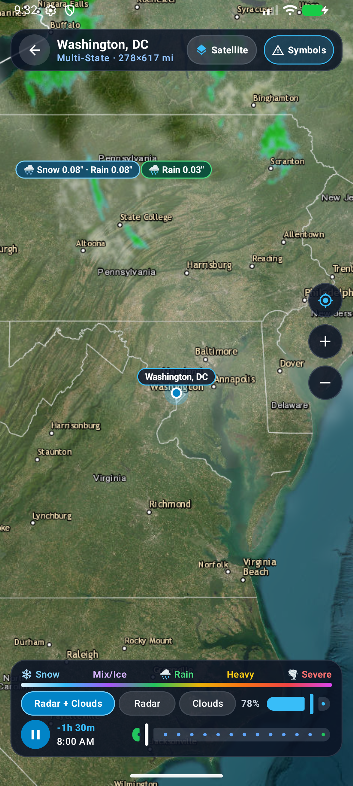
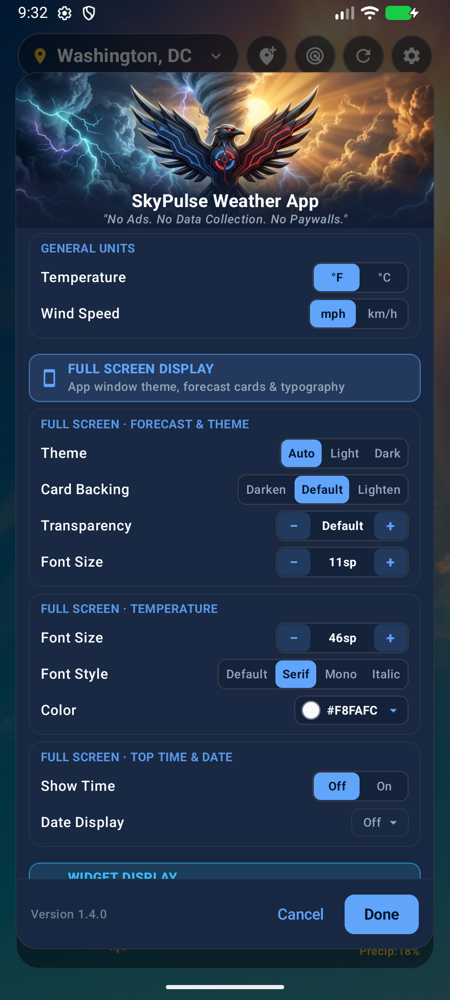
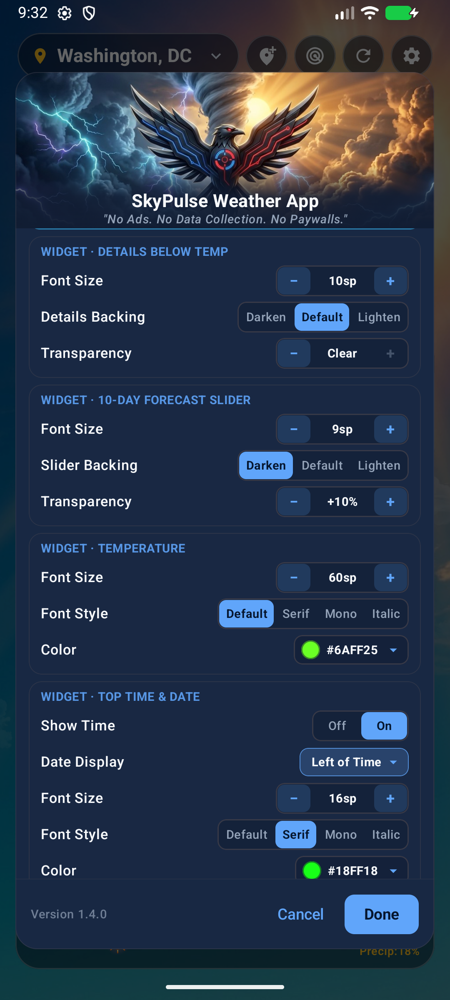
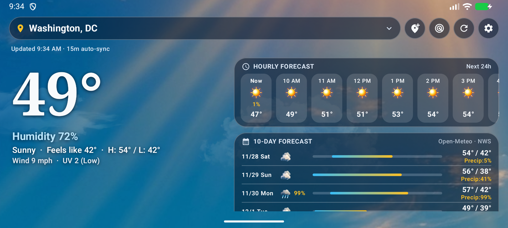

<p align="center">
  
</p>

<h1 align="center">SkyPulse Weather App</h1>

<p align="center">
  <em>"No Ads. No Data Collection. No Paywalls."</em>
</p>

<p align="center">
  
  
  <a href="https://github.com/CROWInnovations/SkyPulseWeather/releases/latest/download/SkyPulseWeather-v1.4.0.apk"></a>
  <a href="./LICENSE"></a>
  <a href="https://crowinnovations.com/apps/"></a>
</p>

---

**SkyPulse Weather App** is a fast, clean, privacy-first Android weather app and home-screen widget suite built for people who want accurate 10-day forecasts, live animated radar & cloud movement maps, rich 3D sky visuals, and flexible widget sizes—without pop-up ads, data collection, or paywalls.

### Direct Android Installation (APK)

- **Latest Signed Release APK (`v1.4.0`)**: [**Download `SkyPulseWeather-v1.4.0.apk`**](https://github.com/CROWInnovations/SkyPulseWeather/releases/latest/download/SkyPulseWeather-v1.4.0.apk) *(or view [GitHub Releases](https://github.com/CROWInnovations/SkyPulseWeather/releases/latest))*
- Signed with the production release key (`com.crowinnovations.skypulseweather`, `Android 8.0+ / API 26–36`), allowing clean manual installation and seamless in-place updates alongside future releases.

---

## Screenshots (Washington, DC)

| 10-Day Swipeable Home Widget | Full-Screen Forecast | Live Radar & Moving Clouds Map |
| :---: | :---: | :---: |
|  |  |  |

| `v1.4.0` Full-Screen Display Settings | `v1.4.0` Widget Display Settings | Widescreen / Landscape View |
| :---: | :---: | :---: |
|  |  |  |

---

## What It Does

- **Interactive Pinch-Zoom Live Radar, Moving Clouds & Severe Storm Map**: Open the top-bar **Radar** button from any saved `City, State` or `ZIP` to view volumetric geostationary satellite cloud motion + color-coded precipitation type & storm severity (`❄️ Snow`, `Mix/Ice`, `🌧️ Rain`, `Heavy`, `🌪️ Severe`) animated from the past 2 hours (`LIVE NOW`) up to `+12h` future forecast. Pinch-zoom smoothly from neighborhood square miles (`~XX sq mi · Local`) out to `Multi-State` and `Continental` views, toggle **Satellite** ↔ **Street Map**, and inspect live **NOAA/NWS** tornado/flood/winter watch & warning polygons (with threat tiers and wind gusts), **NOAA NHC** hurricanes/tropical storms (category, wind speed, forecast cones, and expected rain), and regional expected snow & rain accumulation in inches.
- **Swipeable 10-Day Forecast & Home Widget**: Full 10-day high/low and precipitation forecasts with `M/d EEE` date labels (e.g., `11/28 Sat`) and automatic rain `%` callouts beside rainy clouds above `50%`, plus smooth horizontal finger swiping right and left across all 10 days (`Next 5 ›` / `‹ First 5` also supported) directly on the home-screen widget without triggering widget settings or launcher popups.
- **6 Dedicated Widget Size Options (`5×3`, `5×2`, `4×2`, `2×2`, `2×1`, `1×1`)**: Choose the expanded 10-day forecast card (`5×3`), widescreen 10-day forecast card (`5×2`), classic 10-day forecast card (`4×2`), square weather card (`2×2`), compact horizontal strip (`2×1`), or mini temperature tile (`1×1`)—each tailored cleanly to its allotted space and freely resizable.
- **Separated Full-Screen & Widget Display Styling (`0.5sp` Precision)**: Independently configure **Full Screen Display** vs. **Widget Display** sections with true `1:1` `sp` sizing in `0.5sp` (`−` / `+`) increments across Temperature (`20sp`–`74sp`), Top Centered Clock & Date (`10sp`–`74sp`, enabled by default on the widget so users immediately see the date/time option and can toggle it off anytime), Full-Screen Hourly & 10-Day Forecast (`7sp`–`22sp`), **Widget Details Below Temp** (`7sp`–`18sp` with optional `Darken`/`Default`/`Lighten` + transparency backing), and **Widget 10-Day Forecast Slider** (`7sp`–`17sp` with independent `Darken`/`Default`/`Lighten` + transparency backing).
- **15-Minute Automatic Sync**: Background updates run every **15 minutes** via Android `WorkManager` alongside instant 1-tap refresh.
- **Balanced 3D Skies, Continuous 3D Rain & Prominent 3D Moon Phases**: Glare-balanced golden daytime sun with pulsing/rotating solar rays, drifting 3D cloud variations, continuous 3D falling rain across full screen and larger (`> 2×2`) widgets, active U.S. NOAA severe weather alerts, and astronomically accurate 3D moon phases over a starry Milky Way sky with centered lunar phase labels.
- **Flexible Units & Multi-City Support**: Toggle Fahrenheit (`°F`) or Celsius (`°C`), wind speed in `mph` or `km/h`, and save multiple U.S. ZIP codes, global cities, or optional foreground GPS.

---

## Security & Privacy — Built In from the Ground Up

SkyPulse Weather applies modern mobile security standards so your phone and location stay private:

- **No Ads, No Data Collection, No Paywalls**: Contains zero advertising SDKs, zero behavioral analytics trackers, zero account walls, and zero subscription gates.
- **Foreground-Only Location & Neighborhood Rounding**: If you choose to use GPS, the app checks your location only while open on screen (never in the background), rounds coordinates to a general ~2 km area before requesting weather or radar data, and excludes local location caches from cloud backups.
- **Encrypted Connections Only**: All weather, radar tile, satellite cloud, and alert updates are locked to modern encrypted HTTPS (`TLS 1.2 / 1.3`) using trusted system certificates, blocking unencrypted traffic and unsafe redirects.
- **Sanitized Inputs & Anti-Hijack Protection**: Every search entry and optional custom server link is automatically cleaned and validated before use to block malformed inputs or local-network probing, while touch-overlay protection prevents malicious apps from spoofing taps over the screen.

---

## Build from Source

Requires **JDK 17** and the **Android SDK (`compileSdk 36`, `minSdk 26`)**:

```bash
./gradlew testDebugUnitTest assembleRelease bundleRelease
```

---

## License & Attribution

- Licensed under the [Apache License, Version 2.0](./LICENSE) (see [NOTICE](./NOTICE)).
- Forecast & geocoding data by [Open-Meteo.com](https://open-meteo.com) · U.S. severe weather alerts, MRMS/HRRR radar & tropical advisories by [NOAA / National Weather Service / NHC](https://www.weather.gov) & [Iowa Environmental Mesonet](https://mesonet.agron.iastate.edu) · Satellite imagery by [NASA GIBS](https://earthdata.nasa.gov/eosdis/science-system-description/eosdis-components/gibs) · Base map imagery by [Esri](https://www.esri.com).
- Official Apps Directory: [https://crowinnovations.com/apps/](https://crowinnovations.com/apps/)
- Privacy Policy: [https://crowinnovations.com/apps/skypulseweather/privacy/](https://crowinnovations.com/apps/skypulseweather/privacy/)
